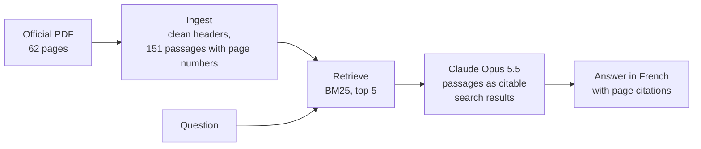

# Nutrition guidelines assistant (RAG with citations)

[](https://github.com/jordanT667/nutrition-rag/actions/workflows/tests.yml) 

A question-answering assistant on the **official French dietary guidelines for adults** (Santé publique France, 2019). It retrieves the relevant passages, answers in French with Claude, and **cites the page** each statement comes from. When the guidelines do not cover a question, it is expected to say so rather than invent a figure.

The project is built around an evaluation: does retrieval actually help, now that a 62-page document fits entirely in a model's context window?

> Research and portfolio project. It summarises public guidelines for the general adult population and does not give medical advice.

## Example

```
$ python -m src.nutrirag.generate "Combien de tranches de jambon par semaine ?"
```

The command prints the answer in French, followed by the pages of the official PDF that the answer cites. The passages it retrieves for this question can be inspected without an API key:

```
$ python -m src.nutrirag.retrieve "Combien de tranches de jambon par semaine ?"
```

## How it works



| Step | Choice | Why |
|---|---|---|
| Corpus | Santé publique France (2019), *Recommandations relatives à l'alimentation, à l'activité physique et à la sédentarité pour les adultes*, 62 pages | Official, public, and the basis of the PNNS guidelines |
| Chunking | Text extracted page by page, running headers removed, paragraphs grouped into ~1,200-character passages that never cross a page: 151 passages | Every citation points to one page of the official PDF |
| Retrieval | BM25 on accent-folded words with light plural stemming; also evaluated: character n-gram TF-IDF and their rank fusion | Runs locally with no model download |
| Generation | Claude Opus 5.5, retrieved passages sent as `search_result` blocks with citations enabled; the system prompt forbids adding facts that are not in the sources | Citations come from the API, not from the model's free text |
| Evaluation | 50 questions, 3 modes, Claude as a judge with a fixed JSON schema, citation accuracy computed in code | See below |

## Evaluation

### Question set

[`eval/questions.jsonl`](eval/questions.jsonl): 50 questions written in French, each with a reference answer and the reference page(s).

| Type | Count | Example |
|---|---|---|
| Factual | 32 | *Combien de produits laitiers par jour sont recommandés ?* |
| Paraphrased | 6 | *Une crème dessert compte-t-elle comme un produit laitier ?* |
| Needs two pages | 2 | *Que recommande-t-on pour avoir assez d'oméga 3 ?* |
| **Not answered by the document** | 10 | *Combien de litres d'eau faut-il boire par jour ?* |

The 10 unanswerable questions test whether the assistant admits the limits of its sources instead of filling the gap from general knowledge.

### Retrieval

Is a reference page among the first *k* passages? (40 answerable questions)

| Method | Top 1 | Top 3 | Top 5 | Top 8 | MRR |
|---|---|---|---|---|---|
| **BM25** | **0.700** | **0.900** | **0.950** | 0.950 | **0.811** |
| Character TF-IDF (3-5 grams) | 0.600 | 0.875 | 0.925 | 0.925 | 0.739 |
| Rank fusion of both | 0.675 | 0.900 | 0.925 | 0.950 | 0.792 |

BM25 alone does best, and fusing it with character n-grams brings nothing on this corpus. The assistant uses BM25 with 5 passages.

### Answers: retrieval vs. whole document vs. no document

> **Status: the harness is built and tested, the paid run has not been published yet.** No answer-quality figure is reported here until it has run; results will be added to `reports/` and to this section.

[`eval_answers.py`](src/nutrirag/eval_answers.py) answers the same 50 questions in three modes:

- **RAG**: the 5 retrieved passages;
- **Whole document**: all 151 passages in context (about 40,000 tokens), cached across questions;
- **No document**: the model's own knowledge, as a baseline.

For each answer it records:

| Measure | How |
|---|---|
| Correct / partial / incorrect | Claude as a judge, given the reference answer and the reference pages, fixed JSON schema |
| Contradiction, invented figures | Same judge, two yes/no fields |
| Abstention on the 10 unanswerable questions | Same judge: does the answer say the guidelines do not cover it, without inventing an official-looking figure? |
| Cites a reference page | Computed in code from the API citations, no judge |
| Cost and latency | From the API usage fields, including cache reads and writes |

Answers and grades are written to `eval/runs/` question by question, so an interrupted run resumes where it stopped.

## Limits

- **The questions were written after reading the document**, so they often reuse its vocabulary. Retrieval scores are likely optimistic compared with real user questions.
- **The retriever was chosen on the same 40 questions** used to report its scores; the three methods are reported side by side for that reason.
- **One document.** The two Anses expert reports the guidelines are based on block automated downloads; they can be added by placing the PDFs in `data/raw/` and declaring them in `ingest.py`.
- **The judge is a Claude model**, like the assistant it grades; it is given the reference answer and the reference pages, and its schema is fixed, but it was not checked against human grading.
- Figures and tables that are images in the PDF (for example the HCSP table in Annex 1) are not extracted.

## Run it

Python 3.13.

```bash
pip install -r requirements.txt
curl -L -o data/raw/spf_recommandations_adultes_2019.pdf https://www.santepubliquefrance.fr/sites/default/files/rdd/document/42466_spf00000619.pdf
python -m src.nutrirag.ingest            # -> data/processed/ (pages and passages)
python -m src.nutrirag.eval_retrieval    # -> reports/retrieval_*.csv, no API key needed
python -m pytest                         # offline tests, the API is replaced by a fake client
```

With an Anthropic API key (in the environment, or in a git-ignored `.env` file as `ANTHROPIC_API_KEY=...`):

```bash
python -m src.nutrirag.generate "Combien de fois par semaine faut-il manger du poisson ?"
python -m src.nutrirag.eval_answers      # 150 answers + 150 gradings; resumes if interrupted
```

## Project structure

```
src/nutrirag/
  ingest.py          PDF -> cleaned pages -> passages with page numbers
  retrieve.py        BM25, character TF-IDF, rank fusion
  generate.py        Claude with citable search results; rag / full / closed modes
  eval_retrieval.py  hit@k and MRR on the question set
  eval_answers.py    answers in each mode, judge, citations, cost and latency
eval/questions.jsonl 50 questions with reference answers and pages
tests/               offline tests
reports/             metrics (CSV)
```

## Source

Santé publique France. *Recommandations relatives à l'alimentation, à l'activité physique et à la sédentarité pour les adultes.* Saint-Maurice, 2019. The PDF is downloaded from the official site and is not redistributed in this repository.
